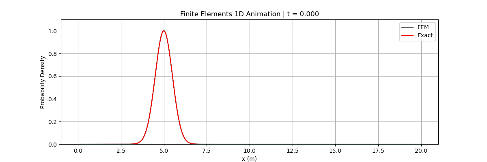

# Time-dependent Schrödinger equation — SBP–SAT numerical solver

Numerical analysis coursework at the Australian National University (MATH3349). This project investigates the one-dimensional time-dependent Schrödinger equation using summation-by-parts (SBP) discretisation, simultaneous approximation term (SAT) boundary treatment and Crank–Nicolson time integration.

The Jupyter notebook combines a mathematical discussion of stability with a computational simulation of a Gaussian wave packet and comparison against an analytical solution.

## Simulation



**[Open the animation directly](simulation.gif)**

The animation compares the numerical (black) and analytical (red) probability densities over time. The notebook also reports the change in the discrete weighted norm.

## Run the notebook from scratch

**Requirements:** Python 3, Jupyter, NumPy, Matplotlib, IPython and Pillow. The notebook uses a built-in Matplotlib inline backend, so no external GUI or special interactive backend is required.

1. Clone the repository, then enter its directory:

   ```bash
   git clone https://github.com/dylanmchatton/schrodinger-sbp-sat-solver.git
   cd schrodinger-sbp-sat-solver
   ```

2. Create a virtual environment:

   **Windows PowerShell:**
   ```powershell
   py -m venv .venv
   .\.venv\Scripts\Activate.ps1
   ```

   **macOS or Linux:**
   ```bash
   python3 -m venv .venv
   source .venv/bin/activate
   ```

3. Install dependencies:

   ```bash
   python -m pip install -r requirements.txt
   ```

4. Launch Jupyter:

   ```bash
   jupyter notebook
   ```

5. Open **[MATH3349 Project 2 (1).ipynb](MATH3349%20Project%202%20(1).ipynb)** and select **Kernel → Restart Kernel and Run All Cells** (wording may vary by Jupyter version).

The final notebook cell writes **`simulation.gif`** into the current working directory, replacing any existing file with that name. The notebook uses dense matrices, so machines with limited memory may run more slowly.

### Verified execution

The uploaded notebook was executed end-to-end from a fresh **Python 3 kernel** in an isolated working directory on 15 October 2026, with its import-only supporting modules present. All 10 executable cells succeeded and `simulation.gif` was generated. In this execution the reported relative change in the discrete norm was approximately **-6.63 × 10⁻¹⁴**. The local environment had NumPy 2.3.5, Matplotlib 3.10.8, IPython 9.14.0 and Pillow 12.3.0. Minor non-fatal `SyntaxWarning` messages occur in some figure-title strings (invalid escape sequences); these do not prevent execution. Results and timings may differ with platform and dependency versions.

The notebook uses the auxiliary files `rate.py`, `time_integrator.py` and `utils.py` for imports, although its demonstrated numerical run does not call their functions.

## Numerical approach

- Constructs numerical first- and second-derivative operators and the SBP norm matrix.
- Imposes boundary terms using SAT-style matrix expressions.
- Advances the semi-discrete system with a Crank–Nicolson update.
- Compares the Gaussian wave packet's numerical probability density to an analytical expression.
- Tracks the discrete weighted norm to investigate stability.

See the notebook for mathematical derivations, assumptions and the full numerical experiment. The successful notebook run is **not** a claim of full scientific verification across all parameter choices.

## Repository contents

| File | Purpose |
| --- | --- |
| [MATH3349 Project 2 (1).ipynb](MATH3349%20Project%202%20(1).ipynb) | Report, solver, figures, animation and stability diagnostic |
| [simulation.gif](simulation.gif) | Pre-generated animated simulation |
| [rate.py](rate.py) | Supporting numerical code |
| [time_integrator.py](time_integrator.py) | Supporting time-integration routines |
| [utils.py](utils.py) | Supporting utility function |
| [requirements.txt](requirements.txt) | Python environment dependencies |

## Background and attribution

This work was completed as part of university coursework taught by **Dr Kenneth Duru** at ANU. The project adapted and extended SBP-related code supplied in the course. It is presented as a student numerical-analysis project rather than original development of the SBP–SAT method.

The mathematical and computational ideas are transferable to other PDE modelling contexts, including wave propagation and fluid dynamics, but **this project itself is not a hydrological model**.
